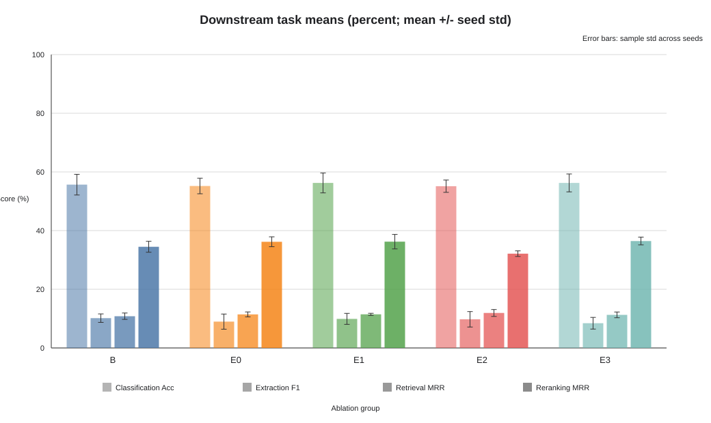
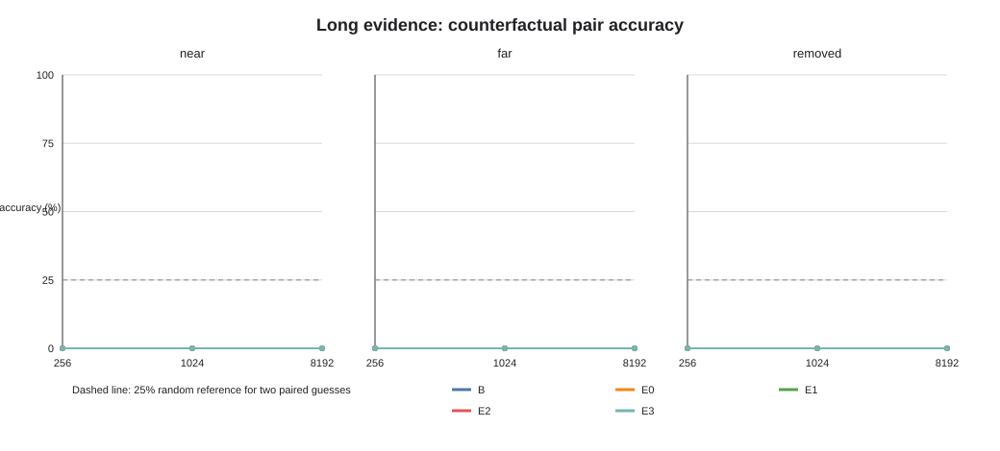
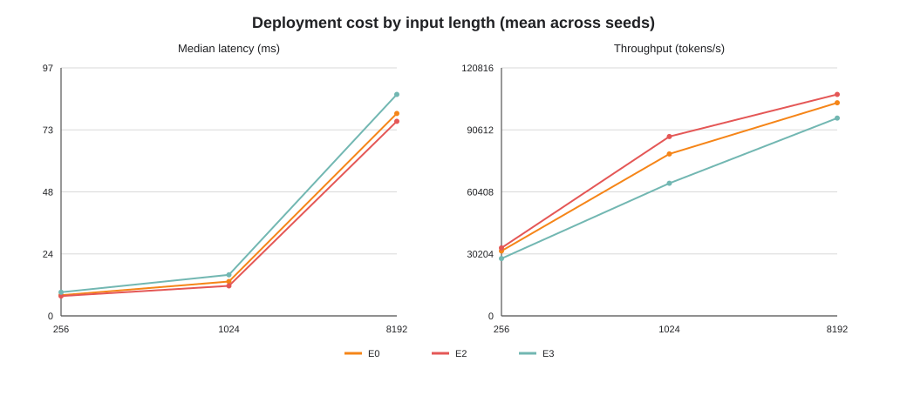

# 下一代 BERT 缩减验证实验报告

## 摘要

本报告对方案文档中提出的下一代双向编码器进行缩减验证。受单卡资源预算限制，实验没有训练约 3 亿参数、8K 上下文的完整模型，而是使用相同的 RoPE、Pre-LayerNorm、GeGLU 以及局部／全局注意力实现，构建 6 层、256 隐藏维度、8192 词表的 6,921,216 参数模型。实验从统一的动态 token MLM 基线出发，分别考察连续片段掩码、局部窗口扩大和句向量对比学习适配三项变化。

实验使用中英文分类、抽取式问答、语义检索和候选重排四类任务，设置三个随机种子，并额外检查长程证据利用、固定任务头的原能力保留和前向部署成本。结果表明：片段掩码在分类上有小幅正向变化，但没有在全部任务上稳定改善；窗口扩大提高了检索 MRR，却明显损害了重排 MRR；当前对比学习适配没有带来稳定的下游收益。长程反事实诊断中所有组均未表现出证据利用能力。因此，本实验没有足够证据把三项变化中的任何一项直接升级为默认配置，但验证流程、结果边界和后续消融方向已经明确。

## 1. 实验目的与范围

方案文档负责说明目标模型的结构选择、训练目标安排和待验证假设。本报告只回答后续实验问题：在固定数据、随机种子和新增计算预算下，三项优先变化是否改善实际任务，是否保留原有读出能力，以及是否增加部署成本。

实验不声称完成了完整模型的预训练，也不把缩减模型的绝对分数外推为 3 亿参数模型的性能。完整规模检查只验证计算图能够构建并完成前向执行；所有任务分数均来自缩减模型。

本次优先验证以下三项变化：

1. 连续片段掩码是否比 token MLM 更有利于抽取和跨片段表示；
2. 局部注意力窗口扩大是否改善检索和长程信息传递；
3. 在 MLM 回放基础上加入双视图句向量对比损失是否改善检索表示。

替换词检测、词表规模、LayerNorm 与 RMSNorm、GeGLU 与 SwiGLU、Text Diffusion 以及从现有多语编码器继续适配，本轮没有运行正式消融，因此不对这些因素填写实验结论。

## 2. 实验环境与模型

### 2.1 硬件和软件

实验环境为 Windows、Python 3.12.4、PyTorch 2.5.1+cu121 和 NumPy 1.26.4。模型参数和 AdamW 状态使用 FP32，前向计算采用 BF16 autocast；注意力使用 PyTorch SDPA 和布尔掩码，未启用 FlashAttention 内核、unpadding、跨文档 packing 或梯度检查点。

### 2.2 完整模型的结构检查

完整目标配置为 24 层、隐藏维度 896、14 个注意力头、GeGLU 中间维度 2400、64,000 词表、最大输入长度 8192，局部窗口为 512，每 3 层设置 1 个全局层，参数量为 **290,199,552**。该模型使用随机初始化，只执行批大小为 1 的编码器前向，不计算完整词表 logits，不建立优化器，也没有进行任务训练。前向检查的中位延迟为：256 token 约 37.89 ms，1024 token 约 56.56 ms，8192 token 约 613.47 ms。上述结果只证明结构可以完成本次前向执行，不能替代完整预训练的资源估计和效果评估。

### 2.3 缩减模型配置

| 项目 | 缩减实验配置 |
| --- | --- |
| 层数 | 6 |
| 隐藏维度 | 256 |
| 注意力头数／每头维度 | 4／64 |
| GeGLU 中间维度 | 688 |
| 词表 | 8192，使用训练分区学习的字节级 BPE |
| 基础局部窗口 | 64 |
| E2 局部窗口 | 128 |
| 全局层 | 每 3 层 1 层，即第 3、6 层 |
| 训练长度 | 256 token |
| 参数量 | 6,921,216 |
| 最大前向诊断长度 | 8192 token |

缩减模型保留了方案中的主要计算模块，但深度、隐藏维度、词表和窗口均显著缩小。因此，E2 中窗口 64 到 128 的结果不能直接等价于完整模型中 512 到 1024 的结果。

## 3. 数据与评测协议

### 3.1 数据划分

实验使用 SST-2 和 ChnSentiCorp 进行分类，使用 SQuAD 1.1 和 CMRC2018 进行抽取、检索和重排。所有处理数据、词表和 SHA256 清单保存在 `data/scaled/manifest.json` 中。

| 语言 | 任务 | 训练集 | 验证集 | 测试集 |
| --- | --- | ---: | ---: | ---: |
| 英文 | 分类 | 512 | 128 | 256 |
| 中文 | 分类 | 512 | 128 | 256 |
| 英文 | 抽取／检索／重排 | 256 | 64 | 128 |
| 中文 | 抽取／检索／重排 | 256 | 64 | 128 |

英文问答数据来自 SQuAD 训练和开发数据，中文问答数据来自 CMRC2018 训练数据的标题分组留出。问答标题和段落进行了划分交集检查，分类文本进行了归一化去重。近重复文本和跨数据源语义污染未完全排除，因此本实验属于受控的缩减验证，不是大规模基准评测。

### 3.2 四类任务

- **分类**：对平均池化表示训练线性分类头，报告中英文 Accuracy 和 Macro-F1。
- **抽取**：使用问题与段落的滑动窗口和线性起止位置头，报告 Exact Match 和 F1。英文先按标准化空白切分，中文按字符切分；两种语言均进行标点处理，英文额外去除冠词，属于本地实现。
- **检索**：分别编码问题和段落，使用平均池化向量的余弦相似度，在每种语言的 128 个测试段落中报告 MRR、Recall@10 和 nDCG@10。每题只标记原段落为正例。
- **重排**：每题构造一个正例和九个固定随机负例，将问题与候选段落联合编码，报告十候选 MRR 和 nDCG@10。由于正例必在候选集中，Recall@10 恒为 1，不作为效果证据。

### 3.3 长程诊断与成本测量

长程诊断使用长度 256、1024 和 8192 的人工构造序列，设置近端、中部、远端和删除证据四个条件。每个条件包含 4 对反事实样本，只改变证据答案 A／B，并同时报告单题准确率和一对样本均正确的成对准确率。双题独立随机猜测的成对参照为 25%。

部署测量使用批大小为 1，分别执行 256、1024 和 8192 token 的编码器前向；每个长度先预热一次，再同步计时三次并取中位数，记录延迟和吞吐。该测量不包括分词、索引搜索、任务头和服务框架。

## 4. 基线与消融设计

每个随机种子先训练共同基础阶段 B：动态 token MLM、15% 掩码率、batch size 8、长度 256，共 3000 步。随后从 B 的检查点分别继续训练 500 步。为了匹配新增训练阶段的编码器调用，E0 至 E3 均使用两次独立 dropout 前向并计算 MLM 损失；E3 额外计算对比损失。

| 组别 | 继续训练目标 | 局部窗口 | 实验作用 |
| --- | --- | ---: | --- |
| B | 基础动态 token MLM，3000 步 | 64 | 共同起点 |
| E0 | token MLM，500 步 | 64 | 匹配新增预算的正式参照 |
| E1 | 50% 步骤使用连续片段掩码，其余使用 token 掩码 | 64 | 检查片段掩码 |
| E2 | token MLM | 128 | 检查窗口扩大 |
| E3 | MLM + 0.1×双视图对比损失 | 64 | 检查对比适配 |

E1 的片段长度从 3 至 8 个 token 采样，选中 token 数与 token 掩码一致。E3 使用温度 0.05 的批内对比损失，不增加投影头；该设置是受控的 SimCSE 式简化，不等同于完整的监督检索训练。

随机种子为 17、42、71。所有实验组使用固定的训练、验证和测试划分，分支阶段使用相同长度和样本预算。报告中的均值和标准差均为三个种子的算术平均和样本标准差。

## 5. 实验结果

### 5.1 总体任务结果

下表的任务分数先对中英文取平均，再对三个随机种子计算均值 ± 样本标准差，单位为百分数。MLM 验证损失保留交叉熵原量纲，数值越低越好。

| 组别 | MLM 验证损失 | 分类 Acc | 分类 Macro-F1 | 抽取 EM | 抽取 F1 | 检索 MRR | 重排 MRR |
| --- | ---: | ---: | ---: | ---: | ---: | ---: | ---: |
| B | 5.9287 ± 0.0257 | 55.66 ± 3.52 | 54.37 ± 3.27 | 2.60 ± 0.45 | 10.16 ± 1.44 | 10.82 ± 1.08 | 34.49 ± 1.85 |
| E0 | 5.9044 ± 0.0303 | 55.21 ± 2.66 | 53.58 ± 2.21 | 2.08 ± 0.23 | 8.98 ± 2.58 | 11.45 ± 0.83 | 36.19 ± 1.69 |
| E1 | 5.9364 ± 0.0278 | 56.25 ± 3.39 | 54.61 ± 3.37 | 1.95 ± 1.03 | 9.92 ± 1.87 | 11.46 ± 0.36 | 36.23 ± 2.46 |
| E2 | 5.9066 ± 0.0306 | 55.14 ± 2.09 | 53.69 ± 1.48 | 2.60 ± 0.45 | 9.77 ± 2.64 | 11.92 ± 1.18 | 32.13 ± 0.95 |
| E3 | 5.9071 ± 0.0289 | 56.25 ± 3.04 | 55.04 ± 3.06 | 1.43 ± 0.23 | 8.43 ± 1.99 | 11.28 ± 0.97 | 36.45 ± 1.31 |

MLM 损失的变化与下游任务变化并不一致。E0 的 MLM 损失低于 B，但分类和抽取下降；E2 的检索 MRR 较高，但重排明显下降；E3 的重排 MRR 略高于 E0，而抽取 F1 和检索 MRR 低于 E0。因此不能用 MLM 损失单独选择默认训练目标。

### 5.2 中英文结果

下表为三个种子的语言分项均值，单位为百分数，列顺序为分类 Acc、抽取 EM、抽取 F1、检索 MRR、检索 Recall@10、重排 MRR、重排 nDCG@10。

| 语言 | 组别 | 分类 Acc | 抽取 EM | 抽取 F1 | 检索 MRR | 检索 R@10 | 重排 MRR | 重排 nDCG@10 |
| --- | --- | ---: | ---: | ---: | ---: | ---: | ---: | ---: |
| 英文 | B | 54.17 | 4.69 | 12.13 | 11.87 | 23.70 | 33.65 | 48.95 |
| 英文 | E0 | 53.39 | 3.91 | 10.62 | 11.82 | 26.04 | 33.73 | 49.03 |
| 英文 | E1 | 54.56 | 3.65 | 11.55 | 11.85 | 26.30 | 33.88 | 49.15 |
| 英文 | E2 | 53.78 | 4.95 | 11.60 | 12.69 | 25.26 | 30.27 | 46.23 |
| 英文 | E3 | 55.08 | 2.60 | 9.21 | 11.78 | 23.96 | 34.29 | 49.35 |
| 中文 | B | 57.16 | 0.52 | 8.19 | 9.77 | 23.44 | 35.32 | 50.36 |
| 中文 | E0 | 57.03 | 0.26 | 7.34 | 11.07 | 23.96 | 38.66 | 52.95 |
| 中文 | E1 | 57.94 | 0.26 | 8.29 | 11.07 | 23.96 | 38.58 | 52.95 |
| 中文 | E2 | 56.51 | 0.26 | 7.94 | 11.14 | 22.14 | 33.99 | 49.27 |
| 中文 | E3 | 57.42 | 0.26 | 7.65 | 10.78 | 21.61 | 38.62 | 52.95 |

### 5.3 相对 E0 的配对差值

下表计算同一种子中实验组减去 E0 的差值，再报告三个种子的均值 ± 样本标准差，单位为百分点。该比较用于判断新增变化，而不是比较共同基础阶段 B 与继续训练阶段的总训练量。

| 组别 | 分类 Acc Δ | 抽取 F1 Δ | 检索 MRR Δ | 重排 MRR Δ |
| --- | ---: | ---: | ---: | ---: |
| E1 | +1.04 ± 0.79 | +0.94 ± 0.72 | +0.01 ± 0.47 | +0.03 ± 1.01 |
| E2 | -0.07 ± 0.63 | +0.79 ± 0.56 | +0.47 ± 0.47 | -4.06 ± 1.81 |
| E3 | +1.04 ± 0.74 | -0.55 ± 0.59 | -0.17 ± 0.71 | +0.26 ± 0.77 |

三个种子和当前测试规模不足以支持显著性结论。E1 的分类和抽取均值提高，但检索和重排变化接近于零，尚未显示稳定的综合收益；E2 的检索改善伴随重排退化；E3 的对比目标没有改善检索和抽取。因此本轮不将任何一项改动列入默认配置。

### 5.4 参照方法

为判断任务难度，使用同一测试样本构造了简单参照。多项式朴素贝叶斯分类准确率为英文 58.59%、中文 70.31%。BM25 在当前候选段落上的检索 MRR 为英文 97.74%、中文 98.18%，Recall@10 均为 100%。128 候选随机排序的期望 MRR 为 4.24%、Recall@10 为 7.81%；十候选随机重排的期望 MRR 为 29.29%。

BM25 的高分说明当前检索候选包含很强的词汇匹配线索，不能据此说明缩减编码器已具备可靠的语义检索能力。该参照也表明后续实验需要增加同实体、同主题和跨语言困难负例。

### 5.5 长程证据利用

表中每项为“单题准确率／反事实成对准确率”，单位为百分数；数值为三个种子的平均。所有实验组在所有长度和位置下均为 50.0／0.0。

| 组别 | 256 近／中／远／删 | 1024 近／中／远／删 | 8192 近／中／远／删 |
| --- | --- | --- | --- |
| B | 50.0／0.0 | 50.0／0.0 | 50.0／0.0 |
| E0 | 50.0／0.0 | 50.0／0.0 | 50.0／0.0 |
| E1 | 50.0／0.0 | 50.0／0.0 | 50.0／0.0 |
| E2 | 50.0／0.0 | 50.0／0.0 | 50.0／0.0 |
| E3 | 50.0／0.0 | 50.0／0.0 | 50.0／0.0 |

模型没有随证据答案 A／B 改变而改变预测，成对准确率为 0，因而不能认为模型利用了人工构造证据。该结果也不能单独归因于局部窗口，因为近端样本同样没有学会。实验没有证明 8K 长文理解能力。

### 5.6 原能力保留

将 B 阶段训练的分类、抽取和重排头固定不变，直接作用于各分支表示，所得分数相对 B 的变化如下，单位为百分点。

| 组别 | 固定分类头 Acc Δ | 固定抽取头 F1 Δ | 固定重排头 MRR Δ |
| --- | ---: | ---: | ---: |
| E0 | -2.60 ± 3.50 | -1.07 ± 0.30 | -0.18 ± 0.27 |
| E1 | -1.43 ± 1.48 | -1.18 ± 0.19 | +0.26 ± 0.95 |
| E2 | -2.28 ± 2.90 | -1.56 ± 0.39 | -0.62 ± 2.38 |
| E3 | -1.89 ± 3.56 | -2.16 ± 0.64 | +0.17 ± 0.41 |

重新训练任务头回答“信息是否仍可被低成本读出”，固定原头回答“原读出接口能否直接保留”。本实验中的原能力仅指缩减模型 B 的任务读出能力，不代表成熟多语编码器的通用知识保留。

### 5.7 训练与部署成本

训练耗时为各阶段实测墙钟时间，均值为三个种子的结果；B 是共同基础阶段，E0 至 E3 是继续训练阶段。

| 组别 | 步数 | 训练时间（秒） |
| --- | ---: | ---: |
| B | 3000 | 126.03 ± 78.55 |
| E0 | 500 | 39.32 ± 26.87 |
| E1 | 500 | 31.20 ± 10.86 |
| E2 | 500 | 24.04 ± 0.10 |
| E3 | 500 | 24.83 ± 0.30 |

B 的种子间耗时波动较大，可能受到首次运行开销、动态频率和系统状态影响，因此不能用墙钟时间给训练目标排序。下表给出编码器批大小为 1 时前向测量的三个种子均值。

| 组别 | 长度 | 中位延迟（ms） | 吞吐（token/s） |
| --- | ---: | ---: | ---: |
| E0 | 256 | 8.09 | 31,645 |
| E0 | 1024 | 13.41 | 78,875 |
| E0 | 8192 | 79.05 | 103,811 |
| E2 | 256 | 7.74 | 33,091 |
| E2 | 1024 | 11.74 | 87,360 |
| E2 | 8192 | 75.98 | 107,871 |
| E3 | 256 | 9.25 | 27,922 |
| E3 | 1024 | 16.03 | 64,624 |
| E3 | 8192 | 86.48 | 96,353 |

E3 的对比项只发生在训练阶段，没有增加推理模块；其推理延迟差异主要属于测量波动。上述数值不包含完整服务链路，不能直接作为线上延迟承诺。

## 6. 结果可视化

图表均由 `results/validation/` 下的固定指标文件自动生成，没有手工修改数据。误差线表示三个种子之间的样本标准差。



图 1  四类下游任务均值对比



图 2  长程证据反事实成对准确率



图 3  部署延迟与吞吐

## 7. 结论

第一，当前缩减实验没有证明片段掩码、窗口扩大或对比学习适配能够在四类任务上稳定优于匹配预算的 token MLM。E1 的分类和抽取 F1 均值有所提高，但检索和重排变化接近于零；E2 的检索收益伴随重排损失；E3 的分类和重排均值略高于 E0，但检索和抽取下降。三个结论都不足以支持默认配置变更。

第二，MLM 验证损失不能作为唯一模型选择标准。E0 的 MLM 损失低于 B，但下游分类和抽取更差；因此某项改动若只降低 MLM 损失而不改善应用表现，不应作为默认组件保留。只有当它同时带来质量非劣、可解释的成本收益或明确的迁移收益时，才有理由进入后续方案。

第三，长程诊断没有观察到证据利用，当前结果不能支持“已经验证 8K 理解”。下一步应扩大真实长文档训练语料，增加跨段落关系和困难负例，并在独立长文档测试集上重新验证窗口、片段目标和检索适配。

## 8. 局限与后续实验

本实验的主要限制如下：

1. 训练模型仅约 692 万参数，训练长度为 256，不能替代 3 亿参数、8K 预训练。
2. 训练语料规模较小，任务样本和无监督语料虽进行了划分审计，但近重复和跨来源污染未完全排除。
3. 测试集规模有限，只有三个随机种子，不能据当前差值进行显著性推断。
4. 抽取指标为本地实现，中文数据不是官方 CMRC 测试集；检索负例主要是随机候选，难度不足。
5. 本轮没有验证词表规模、归一化、FFN 形式、RTD、Text Diffusion 或继续适配现有多语编码器。

后续实验应在固定总 token 数和匹配 FLOPs 的条件下，先建立更强的多语编码器基线，再分别验证窗口大小、全局层间隔、片段掩码比例和对比目标。每项变化均应同时检查四类任务、长程反事实、固定头退化、训练成本和推理成本。

## 9. 复现与文件说明

正式实验入口为 `scripts/run_scaled.py`，固定结果保存在 `results/validation/`。执行以下命令可以运行测试、重建图表并核对指标：

```powershell
python -m pytest tests -q
python scripts/build_figures.py
python scripts/audit_results.py
python scripts/check_target.py
```

完整缩减训练命令为：

```powershell
python scripts/run_scaled.py --seeds 17 42 71 --base-steps 3000 --branch-steps 500 --output results/reproduction
```

`results/validation/` 中保存训练日志、指标、逐例预测、环境信息和审计结果；`results/figures/` 保存本报告引用的 SVG 图。测试审计确认 15 组评测、300 组指标均可由固定预测重新计算，5 项自动化测试全部通过。

